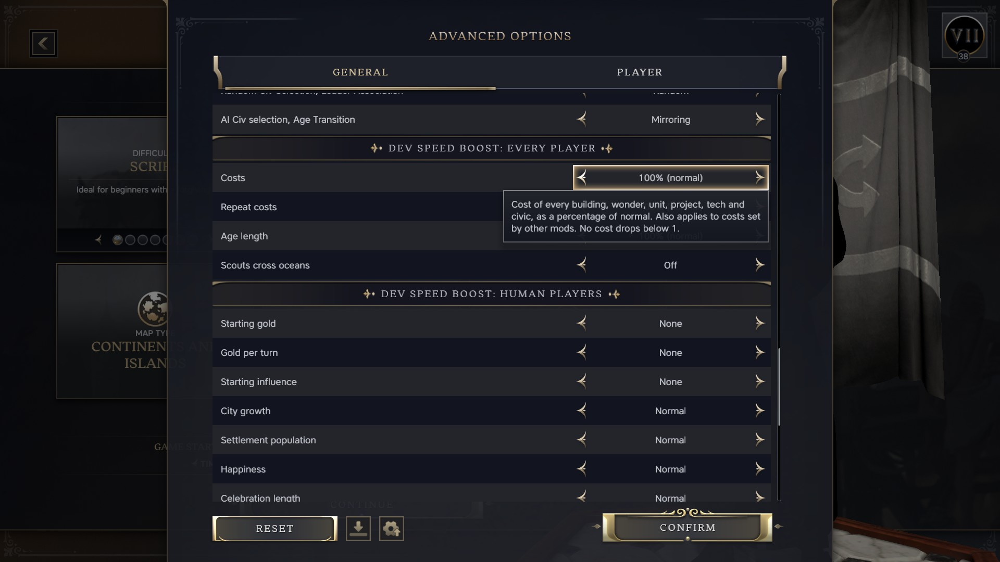
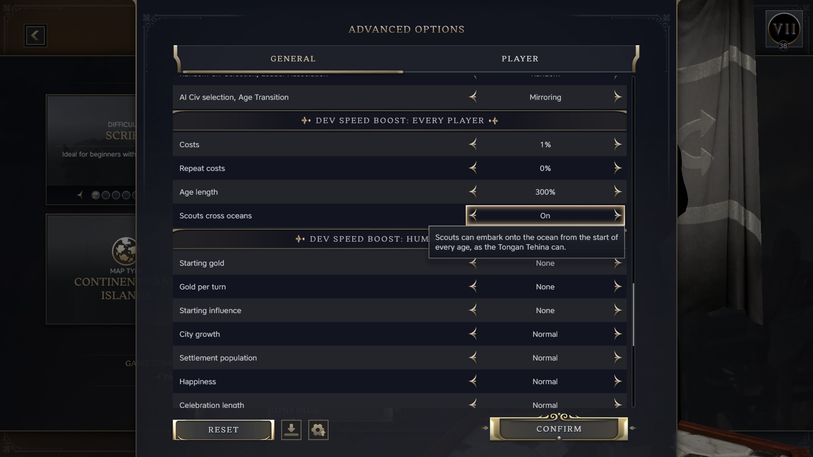

# Dev Speed Boost

A mod that speeds a test game up, so that checking a change takes minutes
rather than an evening: cheaper costs, shorter ages, starting gold, faster
units and more. civ7lab ships it beside the probe. It was a Steam Workshop
mod until 2026-10, and keeps that mod's id, `dev-speed-boost`, so a save made
with the Workshop copy loads with this one.

## Using it

```bash
civ7lab mod install dev-speed-boost      # link it into Mods, once
civ7lab mod uninstall dev-speed-boost    # remove the link
```

Install it once and leave it on. Every option defaults to off, so a normal
game is unaffected.

For a test game, open **Advanced Setup**. The options are in two sections.



**Dev Speed Boost: every player** changes rules the AI shares:

| Option | Choices |
|---|---|
| Costs | 100% (normal), 50%, 25%, 10%, 5%, 1% |
| Repeat costs | 100% (normal), 50%, 0% |
| Age length | 10% to 300% of normal |
| Scouts cross oceans | Off, On |

**Dev Speed Boost: human players** leaves the AI alone:

| Option | Choices |
|---|---|
| Starting gold | None to 1,000,000 |
| Gold per turn | None to +25,000 |
| Starting influence | None to 100,000 |
| City growth | Normal to +1000% Growth Rate |
| Settlement population | Normal to +10 when founded |
| Happiness | Normal to +100 per settlement per turn |
| Celebration length | -50% to +300% |
| Policy slots | Normal to +5 |
| Legacy points | None to +10 in each category |
| Unit movement | Normal to +10 |
| Unit sight | Normal to +5 |
| Ignore terrain | Off, Merchants and Settlers, All units |
| Merchant movement | Normal to +50, on top of unit movement |
| Settler movement | Normal to +20, on top of unit movement |
| Trade route range | Normal to +20, or unlimited |
| Trade routes | Normal to +10 |
| Combat strength | Normal to +50 |
| Commander experience | Normal to +1000% |
| Unit healing | Normal to +100 per turn |
| Reveal map | Off, On |
| Settlement cap | Normal to +100 |

Hover an option to see what it does.

The choices are fixed lists because the game can only switch mod content on
an exact setup value. It cannot read a typed number. To add an amount, see
[Changing the options](#changing-the-options).



Costs cover buildings, wonders, units, projects, techs and civics. Repeat
costs cover how much each copy adds to the next, such as the rising price of
Settlers. The cost cut loads late, so it also scales costs set by the mod you
are testing. Starting gold and influence are granted once, when the game
starts. A game started in the Modern age needs the larger amounts.

## Compatibility

- The options change rules and are fixed once the game starts.
- A save made with the mod enabled needs it enabled to load, even if every
  option was off. Disable the mod before starting a game to share.

## Changing the options

The modinfo, the setup options and the data files are all generated from the
`OPTIONS` table in `tools/dev_speed_boost.py`. To add an amount or an option,
edit the table and run:

```bash
python3 tools/dev_speed_boost.py
```

Commit what it writes. A hand edit under `mod/dev-speed-boost/` is
overwritten, and `test_the_committed_mod_is_what_the_generator_writes` fails
until the generator and the files agree.

The rules for the table:

- **Defaults**: every option's first value must change nothing, so the mod
  can stay installed.
- **Setup values**: never numeric. A value of `"5"` is stored as a number and
  the modinfo criterion never matches it. `config_value` turns each value into
  text such as `COSTS_5`.
- **Setup text**: always a LOC key. The game parses any other string as an ICU
  message, and a comma breaks it. `loc` writes the keys and refuses braces and
  apostrophes, which are ICU syntax.
- **Modifiers**: ids start `DSB_`. Boosts are human-only through
  `REQUIREMENT_PLAYER_IS_HUMAN`. Effects on cities, units or plots are
  attached through the player with `EFFECT_ATTACH_MODIFIERS`.
- **Effects**: before using one, find a shipped modifier with the same
  collection and owner, and copy its arguments. An effect can load without
  error and do nothing when its owner differs. `IgnoreAll=true` on
  `EFFECT_UNIT_ADJUST_IGNORE_MOVEMENT_OBSTACLE` did exactly that on player
  units.
- **Sections**: `group_of` puts an option in "every player" when it changes
  rules the AI shares, and in "human players" otherwise. Tooltips do not
  repeat what the section title says.

## Checking a change

Options apply at game start, so every check is a new game. A change to the
setup sections or their text needs a full game restart as well.

- **Offline**: `civ7lab sql mod/dev-speed-boost --age AGE_ANTIQUITY --prefix
  DSB` applies every option value at once, since it treats every criterion as
  met. Its `options.xml` failure is expected: that file belongs to the setup
  screen's database, not the gameplay one.
- **Which options loaded**: `Modding.log` lists each action group applied at
  game start, such as `* dsb-costs-10`.
- **What the setup screen stored**: `GameCoreAppConfig.log`, keyed by hash.
- **Errors**: `civ7lab logs errors`, or `Database.log` for data and
  `Localization.log` for text.
